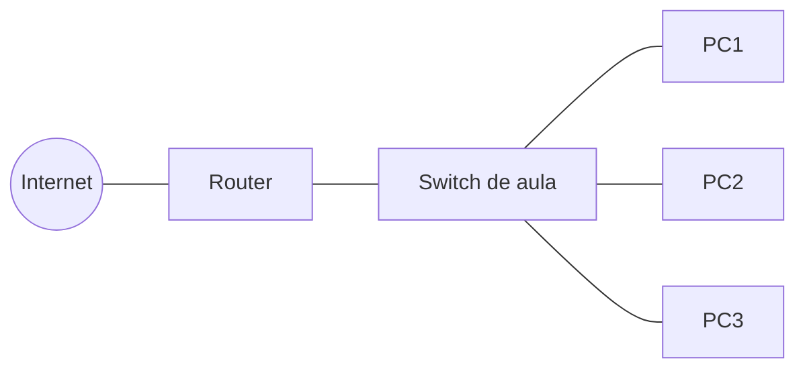
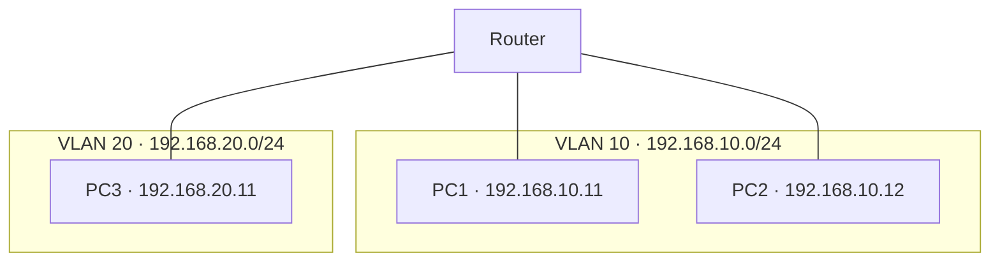

# UT2. Redes

[:material-arrow-left: Volver al índice de todas las unidades](index.md)

!!! tip "Duración"
    10 horas

!!! abstract "Resultado de aprendizaje que se trabaja"
    **RA5.** Interconecta sistemas en red configurando dispositivos y protocolos.

## 2.1. Fundamentos de redes: tipos, topologías y componentes

**¿Qué es una red informática?**

Una **red informática** es un conjunto de dispositivos conectados que pueden intercambiar datos y compartir recursos mediante protocolos de comunicación.

Las redes permiten compartir archivos, utilizar servicios comunes y acceder a aplicaciones que se ejecutan en otros equipos. Por ejemplo, cuando visitas una página web, tu ordenador se comunica a través de una red con un servidor que proporciona los recursos necesarios para mostrarla.

En el desarrollo de aplicaciones web, las redes son fundamentales para comprender cómo se comunican el navegador del usuario, el servidor web y otros servicios, como una API o una base de datos.

**Tipos de redes según su alcance**

Las redes se pueden clasificar según el área que cubren y la tecnología utilizada.

| Tipo | Nombre | Características y ejemplos |
| --- | --- | --- |
| PAN | Personal Area Network | Red de alcance personal, como la conexión Bluetooth entre un móvil y unos auriculares. |
| LAN | Local Area Network | Red de área local que conecta dispositivos en una vivienda, aula, oficina o edificio. |
| WLAN | Wireless Local Area Network | Red local inalámbrica, normalmente basada en Wi-Fi. Es un tipo de LAN. |
| MAN | Metropolitan Area Network | Red que conecta equipos o redes en un área metropolitana. |
| WAN | Wide Area Network | Red de área extensa que conecta redes situadas en lugares geográficos distantes. Internet es el ejemplo más conocido. |

**Ejemplo:** los ordenadores de un aula conectados a un switch forman parte de una LAN. Si se conectan mediante Wi-Fi a través de un punto de acceso, utilizan una WLAN.

**Topologías de red**

La topología de red describe cómo se organizan y conectan los dispositivos. Podemos distinguir entre:

- **Topología física**: describe las conexiones reales entre los dispositivos, el cableado y los equipos de interconexión.
- **Topología lógica**: describe cómo se comunican los dispositivos y cómo circulan los datos, independientemente de la disposición física del cableado.

Las principales topologías son:

| Topología | Descripción | Características |
| --- | --- | --- |
| Bus | Los dispositivos comparten un medio de transmisión común. | Es sencilla, pero un fallo en el cable principal puede afectar a toda la red. Se asocia principalmente a redes antiguas. |
| Estrella | Todos los dispositivos se conectan a un nodo central, habitualmente un switch. | Es habitual en las redes Ethernet actuales. Un fallo en un cable suele afectar solo al dispositivo conectado, pero un fallo del switch puede interrumpir varias conexiones. |
| Anillo | Los dispositivos se conectan formando un circuito cerrado. | Los datos siguen un recorrido determinado. Se encuentra en algunas tecnologías y arquitecturas específicas. |
| Árbol | Combina varias estrellas en una estructura jerárquica. | Facilita organizar redes grandes en diferentes niveles. |
| Malla | Los nodos disponen de varias conexiones entre sí. | Puede proporcionar redundancia y tolerancia a fallos, aunque aumenta la complejidad y el coste. |

En las redes locales Ethernet actuales es frecuente encontrar una topología física en estrella o una estructura jerárquica de estrellas. Esto no significa que todas las redes utilicen la misma topología lógica.

**Componentes principales de una red informática:**

- **Tarjeta de red (NIC)**: interfaz que conecta un equipo a la red, con una dirección MAC única.
- **Switch (conmutador)**: interconecta equipos dentro de una misma LAN, dirigiendo el tráfico según la dirección MAC de destino.
- **Router (encaminador)**: interconecta redes distintas y decide la ruta que deben seguir los paquetes entre ellas.
- **Punto de acceso (AP)**: da conectividad inalámbrica a los dispositivos de una WLAN.
- **Hub (concentrador)**: dispositivo antiguo que repite el tráfico a todos los puertos por igual (en desuso, sustituido por el switch).
- **Medio de transmisión**: cable de cobre, fibra óptica u ondas de radio, según el caso.

!!! note "Idea clave"
    Este apartado da una visión general de los componentes de red; el punto 2.5 profundiza en el funcionamiento de switch y router (tablas de conmutación y de encaminamiento, NAT).

## 2.2. Cableado, conectores y mapa físico/lógico de una red local

**Tipos de cableado más habituales en redes LAN:**

| Cableado | Descripción | Uso |
| --- | --- | --- |
| UTP (par trenzado no apantallado) | 4 pares trenzados, sin blindaje | Redes de oficina y hogar |
| STP/FTP (par trenzado apantallado) | Igual que UTP pero con blindaje | Entornos con interferencias electromagnéticas |
| Coaxial | Conductor central + malla | Prácticamente en desuso en LAN |
| Fibra óptica | Transmisión por pulsos de luz | Backbones, largas distancias, alta velocidad |

**Categorías de cable UTP/FTP** (a mayor categoría, mayor ancho de banda soportado): Cat 5e (hasta 1 Gbit/s), Cat 6 (hasta 10 Gbit/s a distancias cortas), Cat 6A y Cat 7/8 (10 Gbit/s y más, mayor apantallamiento).

**Conectores más comunes:**

- **RJ-45**: conector del cableado de par trenzado (Ethernet).
- **SC / LC**: conectores típicos de fibra óptica.

**Tipos de cable UTP según el cableado interno:**

- **Cable directo (straight-through)**: los pines siguen el mismo orden en ambos extremos. Se usa para conectar dispositivos de distinto nivel (equipo-switch, switch-router).
- **Cable cruzado (crossover)**: los pares de transmisión y recepción están cruzados. Se usa tradicionalmente para conectar dispositivos del mismo nivel (switch-switch, PC-PC), aunque la mayoría de equipos actuales incorporan detección automática (*Auto-MDI-X*) y ya no lo requieren.

**Mapa físico vs. mapa lógico de una red:**

- **Mapa físico**: representa la ubicación real de los dispositivos, el cableado y su disposición en el espacio (racks, plantas, salas).
- **Mapa lógico**: representa cómo fluye la información entre los dispositivos con independencia de su ubicación física: direccionamiento IP, segmentación en subredes/VLAN, rutas.

**Mapa físico** (disposición real de los equipos y el cableado):

**Mapa lógico** (segmentación en subredes/VLAN, con independencia de la ubicación física):

!!! note "Idea clave"
    Dos equipos pueden estar físicamente muy cerca (mismo armario de comunicaciones) y pertenecer a segmentos lógicos completamente distintos (VLAN distintas), y viceversa.

## 2.3. Protocolo TCP/IP: direccionamiento IPv4/IPv6, DNS

**TCP/IP** es el conjunto de protocolos que hace posible la comunicación en la mayoría de redes actuales, incluida Internet. Se organiza en capas, donde cada una se apoya en los servicios de la inferior:

| Capa (modelo TCP/IP) | Función | Ejemplos de protocolo |
| --- | --- | --- |
| Aplicación | Servicios usados directamente por los programas | HTTP, DNS, SMTP, FTP |
| Transporte | Comunicación extremo a extremo | TCP (fiable), UDP (sin conexión) |
| Internet | Direccionamiento y encaminamiento entre redes | IP, ICMP |
| Acceso a la red | Transmisión física de los datos | Ethernet, Wi-Fi |

**Direccionamiento IPv4:** dirección de 32 bits, representada en 4 grupos decimales (0-255) separados por puntos (p. ej. `192.168.1.10`).

- **Máscara de subred**: determina qué parte de la dirección identifica la red y cuál el equipo (host). Se puede expresar en notación decimal (`255.255.255.0`) o **CIDR** (`/24`).
- **Direcciones privadas** (uso interno, no enrutables en Internet): `10.0.0.0/8`, `172.16.0.0/12`, `192.168.0.0/16`.
- **Puerta de enlace (gateway)**: dirección del dispositivo (router) por el que un equipo envía el tráfico destinado a otras redes.

**IPv6:** dirección de 128 bits, representada en 8 grupos hexadecimales (p. ej. `2001:0db8:0000:0000:0000:ff00:0042:8329`, simplificable a `2001:db8::ff00:42:8329`), diseñada para resolver el agotamiento de direcciones de IPv4 y simplificar el direccionamiento.

**DNS (Domain Name System):** servicio distribuido y jerárquico que traduce nombres de dominio legibles (`www.ejemplo.com`) a direcciones IP. En el proceso de **resolución**, el equipo consulta a un servidor DNS (a menudo el del proveedor de Internet o uno público como `8.8.8.8`), que responde directamente si conoce la respuesta o la reenvía a otros servidores DNS hasta obtenerla.

## 2.4. Configuración de redes cableadas e inalámbricas

**Configuración de la dirección IP de un equipo:**

- **Estática**: se asigna manualmente (IP, máscara, puerta de enlace, DNS). Habitual en servidores e impresoras, donde interesa que la dirección no cambie.
- **Dinámica (DHCP)**: un servidor **DHCP** asigna automáticamente la configuración de red a cada equipo que se conecta, durante un tiempo determinado (concesión o *lease*). Es la opción por defecto en la mayoría de redes domésticas y de oficina.

| SO | Configuración gráfica | Comandos / archivos |
| --- | --- | --- |
| Windows | Configuración > Red e Internet | `netsh`, PowerShell `Get-NetIPConfiguration` |
| Linux | NetworkManager (GUI) | `nmcli`, `/etc/netplan/*.yaml` (Ubuntu), `ip` |

**Redes inalámbricas (Wi-Fi):**

- **SSID**: nombre que identifica la red inalámbrica.
- **Estándares 802.11**: sucesivas generaciones (a/b/g/n/ac/ax...) con mejoras de velocidad y alcance; los nombres comerciales actuales son Wi-Fi 4 (802.11n), Wi-Fi 5 (802.11ac) y Wi-Fi 6 (802.11ax).
- **Seguridad**: protocolos de cifrado del tráfico inalámbrico, de menor a mayor seguridad: WEP (obsoleto e inseguro) → WPA → **WPA2** (estándar durante años) → **WPA3** (actual).
- **Ampliación de cobertura**: un único punto de acceso no siempre cubre todo el espacio necesario. Un **repetidor** (o un AP en modo repetidor, mediante el estándar **WDS**, *Wireless Distribution System*) retransmite la señal para ampliar el alcance, a costa de reducir el ancho de banda disponible en cada salto adicional. Las **redes mesh** modernas (varios puntos que se coordinan entre sí, con el mismo SSID e itinerancia automática entre ellos) resuelven el mismo problema de forma más eficiente y con gestión centralizada.

## 2.5. Dispositivos de interconexión y encaminamiento

- **Switch (conmutador)**: opera a nivel de enlace, interconectando equipos de una misma LAN. Aprende qué dirección **MAC** está conectada a cada puerto (tabla de conmutación) y reenvía el tráfico solo al puerto correspondiente, en lugar de a todos (a diferencia del antiguo hub).
- **Router (encaminador)**: opera a nivel de red, interconectando redes distintas (por ejemplo, la LAN doméstica con Internet). Mantiene una **tabla de encaminamiento (routing table)** que indica por qué interfaz/siguiente salto se debe enviar el tráfico según la red de destino.

**Tipos de encaminamiento:**

- **Estático**: las rutas se configuran manualmente; sencillo pero poco escalable.
- **Dinámico**: los routers intercambian información de rutas automáticamente mediante protocolos de encaminamiento (p. ej. OSPF, RIP), adaptándose a cambios en la red.

**NAT (Network Address Translation):** técnica, habitual en routers domésticos, que traduce las direcciones IP privadas de la LAN a una única IP pública para acceder a Internet, permitiendo que muchos equipos compartan una sola dirección pública.

**VLAN (Virtual LAN):** segmenta lógicamente una misma red física en varias redes independientes, sin necesidad de cablear switches separados. Requiere un **switch gestionable** (o switch L3), en cuya configuración se asignan los puertos a una VLAN u otra.

- **Puerto de acceso (access)**: pertenece a una única VLAN; es el modo habitual para conectar equipos finales (PC, impresora).
- **Puerto troncal (trunk)**: transporta el tráfico de varias VLAN a la vez, etiquetando cada trama con el identificador de VLAN correspondiente (estándar **802.1Q**); se usa para enlazar switches entre sí o conectar un router que hace de puerta de enlace de varias VLAN.

!!! note "Idea clave"
    Dos equipos conectados al mismo switch físico, pero en VLAN distintas, no pueden comunicarse entre sí sin pasar por un router (o una función de encaminamiento entre VLAN) — exactamente igual que si estuvieran en dos redes físicamente separadas.

## 2.6. Acceso a redes de área extensa y seguridad en comunicaciones

**Tecnologías de acceso a redes WAN / Internet:**

| Tecnología | Medio | Características |
| --- | --- | --- |
| ADSL | Par de cobre telefónico | Velocidad asimétrica, en desuso |
| Cable (DOCSIS) | Coaxial | Compartido por zona, buena velocidad de bajada |
| Fibra óptica (FTTH) | Fibra hasta el hogar | Alta velocidad simétrica, tecnología actual de referencia |
| Redes móviles | Radiofrecuencia | 4G/5G, cobertura amplia, uso también fijo (FWA) |

**VPN (Virtual Private Network):** crea un túnel cifrado a través de una red no confiable (como Internet), permitiendo acceder de forma segura a una red privada remota como si el equipo estuviera físicamente conectado a ella. Muy usada para el teletrabajo y para interconectar sedes de una empresa.

**Servidor proxy:** actúa como intermediario entre los equipos de una red local e Internet, reenviando las peticiones en su nombre. Es habitual en redes de empresas o centros educativos, con dos funciones principales:

- **Caché de contenidos**: guarda copia de los recursos más solicitados, reduciendo el consumo de ancho de banda y acelerando el acceso a lo que ya han consultado otros equipos de la red.
- **Filtrado de contenidos**: permite bloquear el acceso a determinados sitios o categorías (redes sociales, contenido no apropiado...) de forma centralizada, sin configurar cada equipo por separado.

**Squid** es la implementación libre de proxy más extendida en entornos Linux.

!!! note "Idea clave"
    Un proxy actúa en nombre del cliente hacia Internet (*forward proxy*); no debe confundirse con un **proxy inverso** (*reverse proxy*), que actúa en nombre de un servidor hacia sus clientes y que se estudia en otros módulos relacionados con el despliegue de aplicaciones web.

**Protocolos seguros de comunicación:**

| Protocolo inseguro | Alternativa segura |
| --- | --- |
| HTTP | **HTTPS** (HTTP sobre TLS/SSL) |
| Telnet | **SSH** |
| FTP | **FTPS** / **SFTP** |

**TLS/SSL:** protocolos que cifran la comunicación entre cliente y servidor, garantizando confidencialidad (nadie puede leer los datos), integridad (no se pueden modificar sin detectarlo) y autenticidad (mediante certificados digitales).

## Actividades

**Actividad 2.1 — Mapa físico y lógico de una red**
{: .actividad-titulo}

A partir del plano de un aula con 15 puestos, un switch y un router con salida a Internet, dibuja el **mapa físico** (ubicación de equipos y cableado) y el **mapa lógico** (direccionamiento IP, segmento de red) de esa red.

**Actividad 2.2 — Direccionamiento IP**
{: .actividad-titulo}

Dada la red `192.168.10.0/24`, calcula la dirección de red, la de broadcast y el rango de direcciones válidas para host. Configura después esa dirección de forma estática en una máquina virtual y verifica la conectividad con `ping` hacia otro equipo de la misma red.

**Actividad 2.3 — DHCP vs. IP estática**
{: .actividad-titulo}

En un entorno con dos máquinas virtuales y un servicio DHCP, observa qué configuración de red recibe automáticamente un cliente. Cambia después esa misma máquina a configuración estática y razona en qué casos (servidor, impresora, PC de usuario) conviene cada modalidad.
