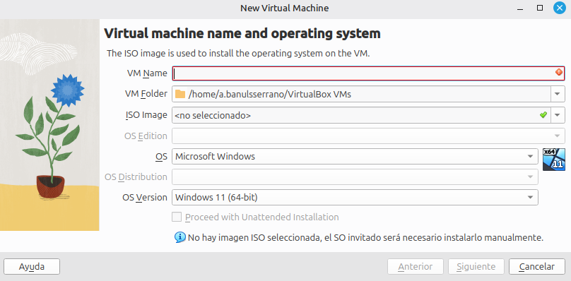
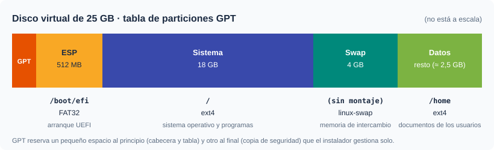

# Guía: tu primera máquina virtual y el particionado

[:material-arrow-left: Volver al índice de todas las unidades](index.md)

Esta guía acompaña a la **[Actividad 3.2](ut3.md#actividades)** y está pensada para quien **crea una máquina virtual por primera vez** o **nunca ha particionado un disco**. Te lleva paso a paso desde VirtualBox vacío hasta un Ubuntu instalado con el esquema de particiones que pide la actividad, y explica el porqué de cada decisión.

!!! tip "Cómo usar esta guía"
    Tenla abierta al lado de VirtualBox y ve siguiendo los pasos en orden. **Haz la captura de pantalla de cada paso en el momento**, para tu manual: algunas pantallas del instalador no se pueden volver a ver sin empezar de nuevo.

## 1. Antes de empezar

### Vocabulario mínimo

| Término | Qué significa |
| --- | --- |
| **Anfitrión** (*host*) | Tu equipo real, el que tiene instalado VirtualBox. |
| **Invitado** (*guest*) | El sistema operativo que se ejecuta *dentro* de la máquina virtual (aquí, Ubuntu). |
| **Imagen ISO** | Un único archivo que contiene una copia exacta de un DVD de instalación. VirtualBox la "introduce" en la VM como si fuera un disco real. |
| **Disco virtual** (VDI) | Un archivo de tu equipo que la VM ve como si fuera su disco duro. Lo que hagas en él (formatear, particionar) **no afecta a tu disco real**. |
| **Tecla Anfitrión** | Por defecto, el **Ctrl derecho**. Si el ratón o el teclado se quedan "atrapados" dentro de la VM, púlsala para recuperarlos. Aparece en la esquina inferior derecha de la ventana de la VM. |

!!! note "No puedes estropear tu ordenador"
    Todo lo que se hace en esta actividad ocurre dentro del disco virtual. Aunque borres o particiones mal, tu equipo real no se ve afectado: en el peor de los casos, se borra la VM y se empieza de nuevo.

### Qué necesitas

- **VirtualBox** instalado (en los talleres, la versión 7.2).
- La **ISO de Ubuntu Desktop** (versión LTS más reciente), descargada desde la web oficial y con su **SHA-256 comprobado** (paso 1 de la actividad).
- Unos **30 GB libres** en el disco del anfitrión: el disco virtual es dinámico y crece hasta 25 GB a medida que se usa.
- Al menos **8 GB de RAM** en el anfitrión, ya que se reservan 4 GB para la VM.

## 2. Crear la máquina virtual

Abre VirtualBox y pulsa **Nueva** (*New*). El asistente tiene varias pantallas; rellénalas así:

**Pantalla 1 — Nombre y sistema operativo** (*Name and Operating System*)

| Campo | Qué poner |
| --- | --- |
| Nombre (*VM Name*) | `UT3-Ubuntu-<apellido>`, por ejemplo `UT3-Ubuntu-Garcia` |
| Carpeta (*VM Folder*) | La que viene por defecto |
| Imagen ISO (*ISO Image*) | Selecciona la ISO de Ubuntu que has descargado |
| SO y versión (*OS / OS Version*) | Linux / Ubuntu (64-bit); normalmente se rellenan solos al elegir la ISO |

{width=500}

!!! warning "Desactiva la instalación desatendida"
    Si aparece marcada la opción **Proceed with Unattended Installation** (o similar), **desmárcala**. Si no, VirtualBox instala Ubuntu solo, con un particionado automático y un usuario genérico, y no podrás hacer el particionado manual que pide la actividad.

**Pantalla 2 — Hardware** (*Hardware*)

| Campo | Qué poner | Por qué |
| --- | --- | --- |
| Memoria base (*Base Memory*) | 4096 MB | Suficiente para Ubuntu Desktop con fluidez |
| Procesadores (*Processors*) | 2 | Con uno solo, el escritorio va muy lento |
| Habilitar EFI (*Enable EFI*) | **Marcado** | La VM arrancará en modo UEFI, como un PC actual; por eso necesitaremos una partición EFI (apartado 4) |

**Pantalla 3 — Disco duro virtual** (*Hard Disk*)

| Campo | Qué poner | Por qué |
| --- | --- | --- |
| Opción | Crear un disco duro virtual nuevo (*Create a Virtual Hard Disk Now*) | La VM aún no tiene disco |
| Tamaño | 25 GB | Es el tamaño sobre el que se ha calculado el esquema de particiones |
| Tipo | VDI | Formato nativo de VirtualBox |
| Reservar tamaño completo (*Pre-allocate Full Size*) | **Desmarcado** | Así el disco es **dinámico**: solo ocupa en tu equipo lo que realmente se usa (punto 3.4) |

**Pantalla 4 — Resumen.** Revisa los datos y pulsa **Terminar** (*Finish*).

### Comprobar la configuración antes de arrancar

Selecciona la VM en la lista, pulsa **Configuración** y revisa:

- **Sistema > Placa base**: *Habilitar EFI* marcado.
- **Almacenamiento**: bajo el controlador aparece la ISO de Ubuntu (icono de disco óptico). Si no está, pulsa sobre la unidad óptica vacía y elige la ISO con el icono de disco de la derecha.
- **Red > Adaptador 1**: conectado a **NAT** (es el valor por defecto; da salida a Internet a la VM).

## 3. Arrancar el instalador

1. Pulsa **Iniciar**. Aparece un menú negro (GRUB, el gestor de arranque de la ISO): elige **Try or Install Ubuntu** y pulsa Intro, o espera unos segundos.
2. Cuando aparezca el asistente de instalación, ve completando sus pantallas:

| Pantalla | Qué elegir |
| --- | --- |
| Idioma | Español |
| Accesibilidad | Sin cambios; pulsa Siguiente |
| Distribución del teclado | Español — Español |
| Conexión a Internet | Conexión por cable (la red NAT de la VM) |
| ¿Qué quieres hacer? | **Instalar Ubuntu** |
| Tipo de instalación | Instalación interactiva |
| Aplicaciones | Selección predeterminada |
| Optimizar el equipo | Puedes marcar ambas opciones (software de terceros y formatos multimedia) |
| **Tipo de instalación del disco** | **Instalación manual** — es el paso del apartado siguiente |

Los nombres exactos de las pantallas pueden variar ligeramente según la versión de Ubuntu; la secuencia es la misma.

## 4. El particionado, paso a paso

### Lo que necesitas entender antes de tocar nada

Una **partición** es un trozo del disco que el sistema trata como si fuera una unidad independiente. Para que Linux pueda usar una partición hay que decidir tres cosas:

1. **Tamaño**: cuánto espacio del disco ocupa.
2. **Sistema de archivos** ("Usar como"): cómo se organizan los datos dentro (ext4, FAT32, swap...).
3. **Punto de montaje**: en qué carpeta del sistema aparece su contenido. En Linux no hay letras de unidad (C:, D:): todas las particiones se "cuelgan" de un único árbol de carpetas que empieza en `/`.

La **tabla de particiones** es el índice que guarda dónde empieza y acaba cada partición. Usaremos **GPT**, la moderna, la que corresponde a un equipo UEFI (punto 3.5.2).

### El esquema que vas a crear y por qué

{width=760}

| Partición | Tamaño | Usar como | Punto de montaje | Para qué sirve |
| --- | --- | --- | --- | --- |
| Partición del sistema EFI (ESP) | 512 MB | Partición del sistema EFI (FAT32) | `/boot/efi` | Guarda el gestor de arranque. Sin ella, una VM con EFI **no arranca**. |
| Sistema | 18 GB | ext4 | `/` | El propio Ubuntu y todos los programas. |
| Intercambio | 4 GB | Área de intercambio (*swap*) | — (no lleva) | Memoria de reserva cuando la RAM se llena. 4 GB porque la VM tiene 4 GB de RAM (tabla del punto 3.5.1). |
| Datos de usuario | El resto (≈ 2,5 GB) | ext4 | `/home` | Las carpetas personales. Al estar separada, se podría reinstalar Ubuntu sin perder los documentos. |

!!! note "Megas y gigas en el instalador"
    Si el instalador pide el tamaño en **MB**, recuerda que 1 GB = 1024 MB: la ESP son **512 MB**, el sistema **18432 MB** y la swap **4096 MB**. Para la última partición no hace falta calcular nada: el instalador propone por defecto **todo el espacio libre que queda**.

### Crear las particiones en el instalador

1. En la pantalla de **Instalación manual** verás el disco virtual (normalmente `sda`, o `nvme0n1`), vacío. Si te ofrece crear una **Nueva tabla de particiones**, acéptalo.
2. Selecciona el **espacio libre** y pulsa **+** para crear una partición. Rellena el cuadro de diálogo con los datos de la **primera fila** de la tabla anterior y pulsa **Aceptar**.
3. Vuelve a seleccionar el espacio libre que queda y repite con la segunda, la tercera y la cuarta fila, **en ese orden**.
4. Abajo, en **Dispositivo donde instalar el gestor de arranque**, deja seleccionado el disco completo (`sda`), no una partición.

!!! warning "Si la partición EFI ya aparece creada"
    Algunas versiones del instalador, al crear la primera partición en un disco vacío de un equipo UEFI, **añaden por su cuenta** una partición EFI. Si la ves en la lista, **no crees otra**: continúa con la de sistema y ajusta la de `/home` al espacio libre que quede. Anótalo en tu manual, junto con el tamaño que le ha dado.

5. **Antes de pulsar Siguiente, comprueba la tabla final** (y haz la captura que pide la entrega):

    - Hay **cuatro** particiones (más, en su caso, pequeños huecos libres de unos pocos MB, que son normales).
    - La de 512 MB es la **partición EFI** y está montada en `/boot/efi`.
    - La de 18 GB es **ext4** con punto de montaje `/`.
    - La de 4 GB es **swap** y no tiene punto de montaje.
    - La del resto es **ext4** con punto de montaje `/home`.

    Si algo no cuadra, selecciona la partición y pulsa **Cambiar** (o **–** para borrarla y volver a crearla). **Nada se escribe en el disco hasta que confirmas la instalación**, así que en esta pantalla puedes corregir todo lo que quieras.

### Errores frecuentes al particionar

| Lo que pasa | Causa | Solución |
| --- | --- | --- |
| Aviso de que **no hay partición del sistema EFI** | No se ha creado la ESP, o se ha creado como FAT32 normal y no como "Partición del sistema EFI" | Cambia esa partición a *Partición del sistema EFI*, o créala si no existe |
| Aviso de que **no se ha definido sistema de archivos raíz** | Ninguna partición tiene el punto de montaje `/` | Selecciona la de 18 GB, pulsa *Cambiar* y asígnale `/` |
| La última partición **no cabe** | Las anteriores se han creado más grandes de la cuenta (por ejemplo, 18 000 MB confundidos con GB) | Revisa los tamaños de cada una y corrígelos |
| No se puede elegir punto de montaje para la swap | Es lo correcto: la swap no se monta en ninguna carpeta | No hay que hacer nada |

## 5. Terminar la instalación

| Pantalla | Qué elegir |
| --- | --- |
| Crear tu cuenta | Tu nombre, nombre del equipo **`ut3-<apellido>`**, usuario y contraseña. Deja marcada la opción de pedir contraseña para iniciar sesión. |
| Zona horaria | Madrid (`Europe/Madrid`) |
| Revisar las opciones | **Última oportunidad para volver atrás.** Comprueba de nuevo el particionado antes de pulsar **Instalar**. |

Al terminar, pulsa **Reiniciar ahora**. Si aparece el mensaje *Please remove the installation medium, then press ENTER*, pulsa Intro: VirtualBox suele retirar la ISO solo. Si la VM vuelve a arrancar el instalador en lugar de tu Ubuntu, apágala, retira la ISO en **Configuración > Almacenamiento** y vuelve a arrancarla.

## 6. Después del primer arranque

Inicia sesión con tu usuario y abre una **Terminal** (Ctrl + Alt + T).

1. **Actualiza el sistema:**

    ```bash
    sudo apt update && sudo apt upgrade -y
    ```

2. **Instala las Guest Additions.** Primero, las herramientas que necesitan para compilarse:

    ```bash
    sudo apt install -y build-essential bzip2
    ```

    Después, en el menú de la ventana de la VM: **Dispositivos > Insertar imagen de CD de las Guest Additions**. Abre el CD que aparece en el escritorio o en el explorador de archivos y ejecuta el instalador desde la terminal:

    ```bash
    sudo sh /media/$USER/VBox_GAs_*/VBoxLinuxAdditions.run
    ```

    Reinicia la VM. Si todo ha ido bien, al cambiar el tamaño de la ventana la resolución de Ubuntu se ajusta sola.

3. Continúa con el resto de tareas y verificaciones de la actividad (instalar `htop`, tomar la instantánea `Instalación limpia` y ejecutar los comandos de comprobación).

## 7. Problemas frecuentes

| Problema | Causa probable | Solución |
| --- | --- | --- |
| Error *VT-x/AMD-V is not available* o la VM no arranca | La virtualización por hardware está desactivada en la BIOS/UEFI del anfitrión | Actívala en la BIOS/UEFI del equipo real (opción *Intel VT-x* / *SVM* / *Virtualization Technology*), o avisa al profesorado |
| Aparece una **tortuga verde** en la barra de estado de la VM y todo va muy lento | Windows está usando Hyper-V y VirtualBox funciona en un modo más lento | Avisa al profesorado; en tu equipo de casa, desactiva *Plataforma de máquina virtual* / Hyper-V en las características de Windows |
| El ratón no sale de la ventana de la VM | La VM ha "capturado" el ratón | Pulsa la **tecla Anfitrión** (Ctrl derecho) |
| Pantalla negra tras elegir *Try or Install Ubuntu* | Poca memoria de vídeo asignada | En Configuración > Pantalla, sube la memoria de vídeo a 64-128 MB |
| La pantalla de Ubuntu es muy pequeña y no se ajusta | Faltan las Guest Additions | Instálalas (apartado 6) |
| Tras instalar, la VM vuelve a arrancar el instalador | La ISO sigue montada | Retírala en Configuración > Almacenamiento |
| Sin Internet dentro de la VM | El adaptador no está en NAT o está desconectado | Configuración > Red > Adaptador 1: *Conectado a: NAT* y *Cable conectado* marcado |

!!! tip "Si algo sale mal, documéntalo"
    Un problema que te aparece y resuelves no es un fallo de la práctica: es una **incidencia**, y va al apartado final de tu manual con su descripción, prioridad, acciones realizadas y estado.
