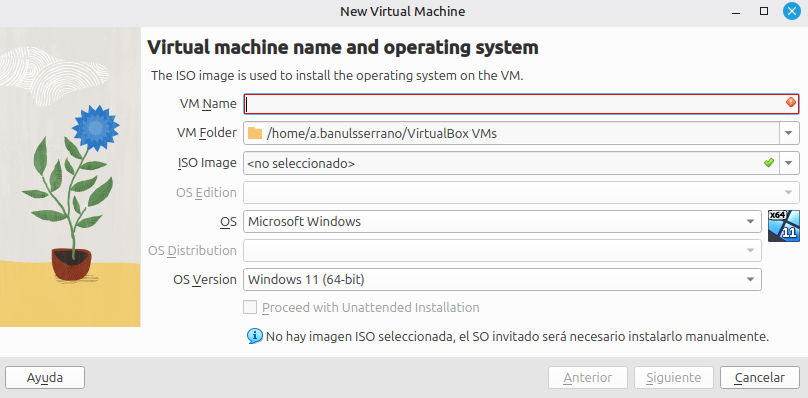

# Guía: configuración de máquinas virtuales en VirtualBox

[:material-arrow-left: Volver al índice de todas las unidades](index.md)

Varias actividades del módulo (especialmente en la UT2) piden configurar y conectar varias **máquinas virtuales (VM)** entre sí: para calcular y comprobar direccionamiento IP, para probar un servicio DHCP, para verificar que dos subredes no se ven entre sí... Esta guía explica cómo crear una VM en **VirtualBox** (versión 7.2, la instalada en los talleres) y, sobre todo, cómo configurar correctamente su **red**, que es la parte que más confusión suele generar la primera vez.

!!! tip "¿Nunca has usado VirtualBox?"
    No hace falta memorizar nada de esta página: tenla abierta al lado mientras configuras tu primera máquina virtual y sigue los pasos en orden.

## 1. Crear una máquina virtual nueva

1. Abre VirtualBox y pulsa **Nueva**.
2. En la primera pantalla del asistente, rellena:
    - **VM Name**: un nombre descriptivo (por ejemplo, `UT2-PC1`).
    - **VM Folder**: la carpeta donde se guardará (el valor por defecto suele servir).
    - **ISO Image**: selecciona la imagen ISO del sistema operativo que vas a instalar, si ya la tienes descargada. Si la dejas en "no seleccionado", podrás instalar el sistema manualmente más adelante.
    - **OS** y **OS Version**: el sistema operativo y la versión concreta (VirtualBox suele detectarlos solo a partir del nombre de la ISO).

    {width=500}

    !!! warning "No marques \"Proceed with Unattended Installation\""
        Esa opción instala el sistema operativo automáticamente, sin que veas ni controles los pasos de la instalación. Para las prácticas del módulo **debe quedar desmarcada**: la instalación se hace manualmente, paso a paso.

3. En las pantallas siguientes del asistente, asigna la **memoria RAM**: para una distribución Linux ligera (sin entorno gráfico pesado) con 1-2 GB suele bastar; consulta los requisitos de la ISO concreta que vayas a instalar y no superes la mitad de la RAM física del equipo del taller, para no afectar al resto de máquinas virtuales que tengas abiertas a la vez.
4. Crea un **disco duro virtual** nuevo: tipo **VDI**, reservado **dinámicamente** (ocupa solo el espacio que realmente usas, hasta el máximo que indiques) y con un tamaño razonable (20-25 GB suele ser suficiente para las prácticas del módulo).

## 2. Configuración básica de hardware

Antes de arrancar la VM, repasa estos ajustes en **Configuración**:

| Sección | Qué ajustar |
| --- | --- |
| Sistema > Procesador | Número de núcleos virtuales asignados (1-2 suele bastar para las prácticas) |
| Pantalla > Memoria de vídeo | El valor por defecto suele ser suficiente si no vas a usar entorno gráfico pesado |
| Almacenamiento | Monta la imagen **ISO** de instalación en la unidad óptica virtual (icono de disco junto a "Controlador: IDE") |

## 3. Configuración de red

Esta es la parte **clave** para las actividades de la UT2. Se configura en **Configuración > Red**, pestaña **Adaptador 1**, desplegable **Conectado a:**.

| Modo | ¿Salida a Internet? | ¿Las VMs se ven entre sí? | ¿Visible desde la red física del aula? |
| --- | --- | --- | --- |
| **NAT** | Sí | No (cada VM está aislada tras su propio NAT) | No |
| **Adaptador puente** (*Bridged*) | Sí | Sí, como si fueran equipos más de la red del aula | Sí |
| **Red interna** (*Internal Network*) | No | Sí, entre las VMs que compartan el mismo nombre de red interna | No |
| **Red solo anfitrión** (*Host-only*) | No | Sí, entre ellas y con el equipo físico (host) | No |
| **Red NAT** (*NAT Network*) | Sí | Sí, entre las VMs de la misma red NAT | No |

!!! warning "Nunca uses Adaptador puente para probar un servidor DHCP"
    Si configuras un servicio DHCP en una VM con **Adaptador puente**, esa VM pasa a repartir direcciones IP en la red real del taller, pudiendo interferir con las máquinas de tus compañeros. Para la Actividad 2.5 (DHCP vs. IP estática) usa siempre **Red interna**: las VMs implicadas se ven entre sí sin tocar la red del centro.

**Cómo conectar varias VMs entre sí con Red interna:** en cada una de las VMs que quieras que se vean, entra en Configuración > Red > Adaptador 1 > Conectado a: **Red interna**, y escribe **el mismo nombre** en el campo "Nombre" (por ejemplo, `ut2-lab`). Solo las VMs que compartan exactamente ese nombre forman parte de la misma red interna.

### Qué adaptador usar en cada actividad

| Actividad | Adaptador recomendado | Motivo |
| --- | --- | --- |
| 2.3 — Direccionamiento IP | Red interna | Solo necesitas que la VM tenga una IP configurada y puedas hacer `ping` a otro equipo de la misma red; no hace falta salida a Internet. |
| 2.4 — Subnetting | Red interna | Igual que la anterior; además te permite comprobar que dos VMs en subredes distintas **no** se alcanzan entre sí, sin riesgo de interferir con la red real. |
| 2.5 — DHCP vs. IP estática | Red interna (mismo nombre en todas las VMs implicadas) | Evita que tu servidor DHCP de pruebas reparta IPs a otros equipos del aula (ver aviso anterior). |

Si en algún momento necesitas que la VM también tenga salida a Internet (por ejemplo, para actualizar paquetes del sistema), puedes añadir un **segundo adaptador de red** (pestaña **Adaptador 2**) en modo **NAT**, y dejar el Adaptador 1 en Red interna para las pruebas de red del módulo.

## 4. Instantáneas (snapshots)

Antes de hacer un cambio que pueda romper la configuración de red o del sistema (por ejemplo, antes de instalar y configurar el servidor DHCP), toma una **instantánea**: botón derecho sobre la VM > **Instantánea** > **Tomar**. Si algo falla, puedes **restaurar** esa instantánea y volver al estado anterior sin tener que reinstalar el sistema desde cero.

## 5. Resumen rápido

1. Nueva VM → nombre, tipo/versión de SO, RAM, disco VDI dinámico.
2. Monta la ISO de instalación en Almacenamiento.
3. Configuración > Red > Adaptador 1 > **Red interna** (mismo nombre en todas las VMs del ejercicio).
4. Toma una instantánea antes de cambios importantes.
5. Arranca la VM e instala el sistema operativo.
