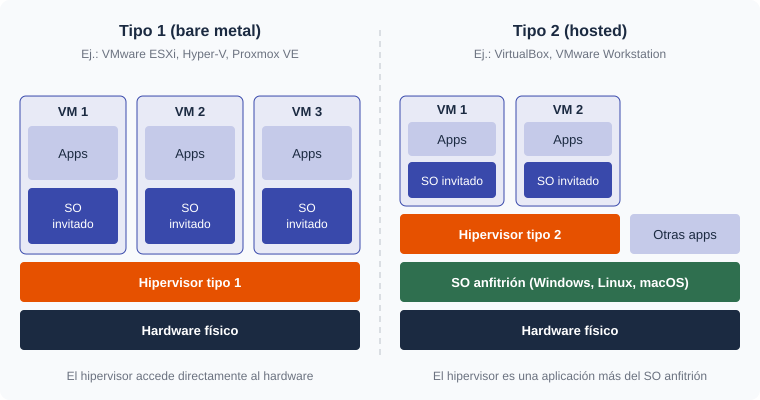
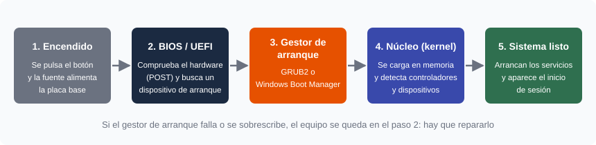

# UT3. Instalación de sistemas operativos

[:material-arrow-left: Volver al índice de todas las unidades](index.md)

!!! tip "Duración"
    10 horas

!!! abstract "Resultado de aprendizaje que se trabaja"
    **RA2.** Instala sistemas operativos planificando el proceso e interpretando documentación técnica.

    *Transversal:* **RA7** (parcial) — instalación y uso de aplicaciones informáticas de propósito general (ofimática, trabajo colaborativo y utilidades).

## 3.1. Introducción a los sistemas operativos

### 3.1.1. Concepto de sistema operativo

Un **sistema operativo (SO)** es el software que gestiona los recursos hardware de un equipo (procesador, memoria, almacenamiento, periféricos) y ofrece a los programas y al usuario una interfaz para utilizarlos, sin necesidad de conocer los detalles técnicos del hardware subyacente.

### 3.1.2. Evolución histórica

- **Sistemas por lotes (batch, años 50-60)**: los trabajos se agrupaban y ejecutaban secuencialmente sin interacción del usuario.
- **Sistemas de tiempo compartido (timesharing, años 60-70)**: varios usuarios comparten el mismo equipo mediante turnos muy cortos de CPU, dando sensación de simultaneidad.
- **Sistemas multiusuario/multitarea (años 80-90)**: consolidación de Unix y, más adelante, de sistemas personales como MS-DOS y Windows.
- **Sistemas gráficos modernos**: Windows, macOS, distribuciones Linux con entorno de escritorio.
- **Sistemas móviles y embebidos**: Android, iOS, sistemas orientados a un único dispositivo o tarea concreta.

### 3.1.3. Sistemas operativos actuales

Hoy en día el mercado se reparte entre unas pocas grandes familias, cada una dominante en un ámbito distinto:

| Familia | Ámbito principal | Licencia | Versiones de referencia (2026) |
| --- | --- | --- | --- |
| **Microsoft Windows** | Escritorio (sistema más usado en PC) y servidores empresariales | Propietaria | Windows 11 (escritorio), Windows Server 2025 |
| **GNU/Linux** | Servidores, nube, supercomputación, desarrollo y también escritorio | Libre (GPL y otras) | Ubuntu 24.04/26.04 LTS, Debian 13, Fedora, Red Hat Enterprise Linux 10, Linux Mint |
| **macOS** | Escritorio y portátiles de Apple | Propietaria (solo en hardware Apple) | macOS 26 "Tahoe" y posteriores |
| **Android** | Móviles y tabletas (sistema más usado del mundo en número de dispositivos) | Base libre (AOSP) + servicios propietarios de Google | Android 16 y posteriores |
| **iOS / iPadOS** | Móviles y tabletas de Apple | Propietaria | iOS 26 y posteriores |
| **ChromeOS** | Portátiles ligeros orientados a la nube, muy extendidos en educación | Propietaria (basada en Linux) | Actualización continua |

**Características de cada familia:**

- **Windows**: gran compatibilidad con software comercial y videojuegos, muy implantado en empresas (integración con Active Directory y Microsoft 365). Windows 11 exige hardware relativamente moderno (**TPM 2.0**, **arranque seguro UEFI** y procesadores recientes), lo que deja fuera a muchos equipos antiguos. **Windows 10 dejó de recibir soporte general en octubre de 2025**, por lo que los equipos que siguen con él quedan expuestos a vulnerabilidades sin parchear.
- **GNU/Linux**: no es un único sistema, sino un **núcleo (kernel Linux)** sobre el que se construyen numerosas **distribuciones**, que se diferencian en su gestor de paquetes, su entorno de escritorio (GNOME, KDE Plasma, Xfce...) y su ciclo de publicación. Domina en servidores, en la nube y en el 100 % de los superordenadores del TOP500; además, el propio Android usa el kernel Linux.
- **macOS**: sistema de tipo Unix (certificado UNIX), muy valorado en diseño y desarrollo de software; solo se puede instalar legalmente en hardware de Apple, que desde 2020 usa sus propios procesadores **Apple Silicon** (arquitectura ARM).
- **Android e iOS**: diseñados para pantallas táctiles, con aplicaciones aisladas entre sí (*sandboxing*) y distribuidas principalmente a través de tiendas oficiales (Google Play, App Store).

**Ciclos de vida y soporte:** a la hora de elegir un SO, especialmente en una empresa, es tan importante su **periodo de soporte** como sus funciones, ya que un sistema sin actualizaciones de seguridad es un riesgo.

- **Versiones LTS (*Long Term Support*)**: reciben actualizaciones de seguridad durante muchos años (p. ej., Ubuntu LTS: 5 años de soporte estándar, ampliables; se publica una cada dos años, en abril de los años pares). Recomendadas para servidores y equipos de empresa.
- **Versiones de publicación periódica (*point release*)**: versiones con fecha fija y soporte más corto (Fedora, las versiones intermedias de Ubuntu).
- ***Rolling release***: el sistema se actualiza de forma continua, sin "versiones" como tales, y siempre tiene el software más reciente (Arch Linux, openSUSE Tumbleweed). Más novedades, pero más riesgo de que algo deje de funcionar tras una actualización.
- **Windows como servicio**: Windows 11 recibe una gran actualización de funciones al año, y cada una tiene un periodo de soporte limitado; las ediciones **LTSC** (*Long-Term Servicing Channel*) se usan en entornos que necesitan estabilidad durante años (cajeros, equipos industriales, sanitarios).

**Tendencias actuales:**

- **Arquitectura ARM** en ordenadores personales (Apple Silicon, portátiles Windows con procesadores Snapdragon), además de la tradicional x86-64.
- **Integración de la inteligencia artificial** en el propio sistema operativo (asistentes integrados como Copilot en Windows o Apple Intelligence en macOS/iOS).
- **Mayor exigencia de seguridad por hardware**: TPM, arranque seguro, cifrado de disco activado por defecto (BitLocker, FileVault).
- **Sistemas orientados a la nube**: ChromeOS, escritorios virtuales y aplicaciones web que reducen la dependencia del SO local.
- **Sistemas inmutables**: el sistema base es de solo lectura y se actualiza de forma atómica, como un bloque, pudiendo volver a la versión anterior si algo falla (Fedora Silverblue, SteamOS, ChromeOS).

!!! note "Idea clave"
    No existe un "mejor sistema operativo" en abstracto: la elección depende del **ámbito de uso** (escritorio, servidor, móvil), del **software que se necesita ejecutar**, del **hardware disponible**, del **coste de licencias** y del **periodo de soporte** que ofrece el fabricante.

## 3.2. Tipos de sistemas operativos

### 3.2.1. Clasificación de los sistemas operativos

Los sistemas operativos pueden clasificarse según distintos criterios. Un mismo sistema pertenece a una categoría de cada criterio: por ejemplo, Windows 11 es multiusuario, multitarea, multiprocesador, con interfaz gráfica, de núcleo híbrido y orientado al escritorio.

| Criterio | Categorías |
| --- | --- |
| Número de usuarios | Monousuario / Multiusuario |
| Número de tareas | Monotarea / Multitarea |
| Número de procesadores atendidos | Monoprocesador / Multiprocesador |
| Tipo de interfaz | Texto (CLI) / Gráfica (GUI) |
| Arquitectura del núcleo | Monolítico, microkernel, híbrido |
| Ámbito de uso | Escritorio, servidor, móvil, embebido |

### 3.2.2. Tipos de software y licencias

**Software de sistema vs. software de aplicación:**

- **Software de sistema**: el propio SO y las herramientas que gestionan el hardware (drivers, utilidades de sistema).
- **Software de aplicación**: programas orientados a que el usuario realice una tarea concreta (ofimática, navegación, edición, etc.).

**Clasificación según el tipo de licencia:**

| Tipo de licencia | Código fuente | Coste | Ejemplo |
| --- | --- | --- | --- |
| Software libre | Disponible, se puede modificar y redistribuir | Puede ser gratuito o de pago | LibreOffice, GNU/Linux |
| Software propietario | Cerrado | Habitualmente de pago | Microsoft Windows, Adobe Photoshop |
| Freeware | No necesariamente disponible | Gratuito, sin acceso al código | Adobe Acrobat Reader |
| Shareware | No necesariamente disponible | Gratuito por tiempo/funciones limitadas, después de pago | Versiones de prueba (*trial*) |
| Dominio público | Puede estar disponible | Gratuito, sin restricciones de autor | Software con copyright expirado |
| OEM | — | Vinculado a la venta de hardware | Windows preinstalado en un equipo nuevo |

**Licencias de software libre más comunes:** GPL (copyleft: las modificaciones deben mantenerse libres), MIT y BSD (permisivas: permiten uso en proyectos propietarios), Apache 2.0.

**Modalidades de licenciamiento comercial:** licencia individual (*retail*), licencia por volumen (para empresas/centros educativos), licencia OEM (atada a un equipo), suscripción (SaaS, pago periódico, p. ej. Microsoft 365).

!!! note "Idea clave"
    "Gratuito" (freeware) y "libre" (open source) no son sinónimos: un programa puede ser gratuito y a la vez cerrado (no se puede ver ni modificar su código).

## 3.3. Funciones del sistema operativo

El sistema operativo actúa a la vez como **gestor de recursos** (reparte el hardware entre los programas que lo necesitan) y como **máquina extendida** (oculta la complejidad del hardware y ofrece a programas y usuarios una forma sencilla de utilizarlo). Estas tareas se agrupan en las siguientes funciones:

### 3.3.1. Gestión de procesos

Un **programa** es un archivo ejecutable almacenado en disco; un **proceso** es ese programa *en ejecución*, con su código, sus datos en memoria, el estado de los registros de la CPU y los recursos que tiene asignados (archivos abiertos, conexiones...). Un mismo programa puede dar lugar a varios procesos (por ejemplo, dos ventanas independientes de un editor de texto).

El SO se encarga de **crear y finalizar procesos**, de **repartir el tiempo de CPU** entre ellos y de permitir que se **comuniquen y sincronicen** entre sí. Para ello guarda la información de cada proceso en una estructura llamada **bloque de control de proceso (PCB)**, que incluye su identificador (**PID**), su estado, su prioridad y el contenido de los registros de la CPU.

Durante su vida, un proceso pasa por distintos **estados**:

- **Nuevo**: el proceso se está creando y el SO aún no lo ha admitido para ejecutarse.
- **Listo (preparado)**: tiene todo lo necesario para ejecutarse y solo espera a que le asignen la CPU.
- **En ejecución**: sus instrucciones se están ejecutando en la CPU. En cada núcleo solo puede haber un proceso en este estado a la vez.
- **Bloqueado (en espera)**: no puede continuar hasta que ocurra algo externo, como que termine una operación de E/S (lectura de disco, pulsación de una tecla, llegada de datos por la red).
- **Terminado**: ha finalizado su ejecución y el SO libera los recursos que tenía asignados.

{width=700}

Las **transiciones** entre estados son:

| Transición | Cuándo se produce |
| --- | --- |
| Nuevo → Listo | El SO admite el proceso y le reserva los recursos iniciales. |
| Listo → En ejecución | El **planificador** elige ese proceso y le asigna la CPU. |
| En ejecución → Listo | Se agota su porción de tiempo (**quantum**) o llega un proceso de mayor prioridad que lo expulsa (**expropiación**). |
| En ejecución → Bloqueado | El proceso solicita una operación de E/S o espera un evento y no puede continuar. |
| Bloqueado → Listo | La E/S o el evento esperado se completa. El proceso **no** vuelve directamente a ejecución: debe esperar de nuevo su turno. |
| En ejecución → Terminado | El proceso finaliza normalmente, por un error o porque otro proceso (o el usuario) lo termina. |

Cada vez que la CPU pasa de un proceso a otro, el SO realiza un **cambio de contexto**: guarda en el PCB el estado del proceso saliente y carga el del entrante. Al hacerse cientos de veces por segundo, el usuario percibe que todos los programas se ejecutan simultáneamente (**multitarea**).

El componente que decide qué proceso listo pasa a ejecutarse es el **planificador (scheduler)**, que sigue un **algoritmo de planificación**. Algunos de los más conocidos son:

- **FCFS (*First Come, First Served*)**: por orden de llegada, como una cola.
- **SJF (*Shortest Job First*)**: primero el proceso con la ráfaga de CPU más corta.
- **Round Robin (turno rotatorio)**: cada proceso se ejecuta durante un quantum fijo y vuelve al final de la cola. Es la base de los sistemas de tiempo compartido.
- **Por prioridades**: se ejecuta antes el proceso con mayor prioridad. Los sistemas actuales combinan prioridades y turnos rotatorios.

!!! tip "Procesos e hilos"
    Un proceso puede dividirse en varios **hilos (threads)**: unidades de ejecución que comparten la memoria y los recursos del proceso, pero pueden ejecutarse en paralelo en distintos núcleos. Por ejemplo, un navegador usa un hilo para dibujar la página y otros para descargar contenido al mismo tiempo.

    Puedes ver los procesos de tu equipo, su PID y su estado con el **Administrador de tareas** en Windows, o con `ps aux`, `top` o `htop` en Linux.

### 3.3.2. Gestión de memoria

La memoria RAM es limitada y la comparten el propio SO y todos los procesos en ejecución. El SO se encarga de:

- **Asignar y liberar memoria**: reserva espacio a cada proceso cuando se crea o lo solicita, y lo recupera cuando termina.
- **Proteger la memoria**: impide que un proceso lea o modifique la memoria de otro o la del propio SO. Si lo intenta, el SO lo detiene (el típico error de "violación de segmento" o "acceso a memoria no válido").
- **Gestionar la memoria virtual**: cada proceso trabaja con un espacio de direcciones propio, que el SO traduce a direcciones físicas de la RAM con ayuda del hardware (**MMU**). La memoria se divide en bloques de tamaño fijo llamados **páginas**; las que no caben o no se usan pueden llevarse temporalmente al disco (**swap** o archivo de paginación, ver punto 3.5.1) y traerse de vuelta cuando se necesitan. Así, se pueden ejecutar más programas de los que cabrían en la RAM física.

!!! note "Idea clave"
    Cuando la RAM se queda corta y el sistema tiene que mover páginas al disco y del disco continuamente, el equipo se ralentiza muchísimo (se dice que "hiperpagina", en inglés *thrashing*). Por eso ampliar la RAM es una de las mejoras de rendimiento más eficaces.

### 3.3.3. Gestión de archivos y almacenamiento

Los discos solo almacenan bloques de datos; el SO los organiza mediante un **sistema de archivos** para que el usuario trabaje con **archivos** y **carpetas (directorios)** organizados en una jerarquía. El SO se encarga de:

- **Crear, leer, modificar, copiar, mover y eliminar** archivos y directorios.
- Llevar el control de **qué bloques del disco ocupa cada archivo** y cuáles están libres.
- Guardar los **metadatos** de cada archivo: nombre, tamaño, fechas de creación y modificación, propietario y permisos.
- **Controlar el acceso**: quién puede leer, modificar o ejecutar cada archivo.

Cada sistema operativo usa sus propios sistemas de archivos: **NTFS** en Windows, **ext4** o **Btrfs** en Linux, **APFS** en macOS, y **FAT32** o **exFAT** en memorias USB y tarjetas, por ser compatibles con casi todos los sistemas. Se estudian en detalle en la siguiente unidad.

### 3.3.4. Gestión de dispositivos de entrada/salida

Existen miles de periféricos distintos (teclados, impresoras, discos, tarjetas de red...), cada uno con su propia forma de funcionar. El SO se comunica con ellos a través de **controladores (drivers)**: pequeños programas, normalmente proporcionados por el fabricante, que "traducen" las órdenes genéricas del SO a las instrucciones concretas que entiende cada dispositivo. Gracias a ellos, un programa puede imprimir sin saber qué modelo de impresora hay conectada.

Además, el SO:

- Atiende las **interrupciones**: avisos que envían los dispositivos a la CPU cuando necesitan atención (por ejemplo, "ha llegado un paquete de red" o "ya he terminado de leer el bloque de disco"), sin que la CPU tenga que estar preguntando continuamente.
- Usa **búferes y colas** para compensar la diferencia de velocidad entre la CPU y los periféricos. Por ejemplo, la **cola de impresión** (*spooling*) permite enviar varios documentos a la impresora y seguir trabajando mientras se imprimen.
- Detecta los dispositivos al conectarlos y carga su controlador automáticamente (**Plug and Play**).

### 3.3.5. Interfaz con el usuario

El SO ofrece al usuario una forma de comunicarse con el equipo:

- **Interfaz de línea de comandos (CLI)**: el usuario escribe órdenes en un intérprete de comandos (*shell*), como **Bash** en Linux o **PowerShell** y **CMD** en Windows. Es más difícil de aprender, pero muy potente y permite **automatizar tareas mediante scripts** y administrar equipos remotos. Es la interfaz habitual en servidores.
- **Interfaz gráfica de usuario (GUI)**: ventanas, iconos, menús y puntero (*WIMP*). Es más intuitiva y la habitual en equipos de escritorio y móviles (en estos últimos, con interfaz **táctil**).

Además, el SO ofrece a los programas una interfaz propia: las **llamadas al sistema** (*system calls*), funciones mediante las cuales una aplicación pide al SO que realice por ella operaciones que no puede hacer directamente, como abrir un archivo, crear un proceso o enviar datos por la red.

### 3.3.6. Seguridad y control de acceso

En un sistema multiusuario, el SO debe proteger los datos y recursos de cada usuario y del propio sistema:

- **Autenticación**: comprueba la identidad de quien accede, mediante contraseña, PIN, biometría (huella, reconocimiento facial) o varios factores combinados.
- **Autorización y permisos**: determina qué puede hacer cada usuario con cada recurso (leer, escribir, ejecutar). Se distingue entre **usuarios estándar** y **administradores** (*root* en Linux), y las tareas que afectan al sistema exigen elevar privilegios (**UAC** en Windows, `sudo` en Linux).
- **Aislamiento**: los procesos se ejecutan separados entre sí y del núcleo, para que un fallo o un programa malicioso no afecte al resto del sistema.
- **Auditoría**: registra los eventos importantes (inicios de sesión, errores, cambios de configuración) en **registros (logs)**: el Visor de eventos en Windows o `journalctl` y `/var/log` en Linux.

### 3.3.7. Gestión de red y comunicaciones

Los sistemas operativos actuales incluyen la **pila de protocolos TCP/IP** y las herramientas necesarias para conectar el equipo a una red: configuración de direcciones IP, resolución de nombres (DNS), cortafuegos integrado y servicios para compartir archivos e impresoras.

## 3.4. Virtualización

La **virtualización** permite ejecutar uno o varios sistemas operativos "invitados" (guest) de forma aislada sobre un mismo equipo físico "anfitrión" (host), compartiendo sus recursos hardware.

**Tipos de hipervisor** (software que crea y gestiona las máquinas virtuales):

| Tipo | Descripción | Ejemplos |
| --- | --- | --- |
| Tipo 1 (bare metal) | Se ejecuta directamente sobre el hardware, sin SO anfitrión | VMware ESXi, Microsoft Hyper-V, Proxmox VE |
| Tipo 2 (hosted) | Se ejecuta como una aplicación sobre un SO anfitrión ya instalado | VirtualBox, VMware Workstation, Parallels |

{width=700}

**Ventajas de la virtualización:** aislamiento entre sistemas, aprovechamiento del hardware, facilidad para probar sistemas operativos sin arriesgar el equipo real, uso de **instantáneas (snapshots)** para volver a un estado anterior, portabilidad de las máquinas virtuales entre equipos.

**Conceptos relacionados:**

- **Máquina virtual (VM)**: equipo completo simulado por software, con su propio SO, disco virtual y recursos asignados.
- **Contenedores** (Docker, LXC): virtualización a nivel de sistema operativo, más ligera que una VM completa porque comparten el kernel del host; se estudian en detalle en otros módulos, pero conviene conocer la diferencia con una VM tradicional.

???+ example "Ampliación: contenedor vs. máquina virtual con Docker"
    Si ya has terminado las actividades básicas de esta unidad, puedes comprobar por ti mismo/a la diferencia entre contenedor y VM:

    1. Instala Docker Desktop (o Docker Engine en Linux) en tu equipo o en una VM.
    2. Arranca el mismo servicio de dos formas: como contenedor (`docker run -d -p 8080:80 nginx`) y como máquina virtual completa con ese mismo servicio instalado.
    3. Compara el tiempo desde que lo lanzas hasta que responde, el espacio en disco ocupado y la memoria RAM consumida (`docker stats` frente al Administrador de tareas/`htop` de la VM).
    4. Con `docker exec -it <contenedor> bash` y luego `uname -a`, comprueba que el kernel que ve el contenedor es el mismo que el de tu equipo anfitrión — a diferencia de la VM, que tiene el suyo propio.

    No es una actividad evaluada: es una forma de comprobar de primera mano por qué un contenedor no sirve para las actividades de esta unidad (no tiene BIOS/UEFI, gestor de arranque ni disco que particionar) y, en cambio, resulta mucho más ligero y rápido para desplegar un servicio ya construido — algo que se estudiará en detalle en módulos posteriores de despliegue.

**Discos virtuales:** cada VM almacena su disco como uno o varios archivos en el sistema de archivos del anfitrión, en formatos como **VDI** (nativo de VirtualBox), **VMDK** (VMware, el más extendido para el intercambio entre plataformas) o **VHD/VHDX** (Hyper-V). Al crear el disco se elige entre:

- **Tamaño dinámico**: el archivo ocupa en el anfitrión solo el espacio realmente usado por la VM, y va creciendo hasta el máximo definido. Es la opción recomendada en la mayoría de los casos.
- **Tamaño fijo**: reserva de entrada todo el espacio máximo en el anfitrión. Ofrece un rendimiento algo más constante, a costa de ocupar desde el principio todo el espacio, tanto se use como si no.

!!! note "Idea clave"
    Con un disco de tamaño dinámico, el sistema operativo invitado "cree" que dispone de todo el espacio del disco virtual, aunque el anfitrión no le haya asignado aún ese espacio real; si el disco del anfitrión se llena antes de alcanzar ese máximo, la máquina virtual puede fallar de forma abrupta.

**Guest Additions / VMware Tools:** paquete de controladores y utilidades que se instala *dentro* del sistema operativo invitado (no en el anfitrión) y mejora la integración entre ambos: resolución de pantalla ajustable, portapapeles compartido, arrastrar y soltar archivos, carpetas compartidas y mejor rendimiento gráfico y de red. Sin este paquete instalado, la máquina virtual funciona, pero con prestaciones e integración limitadas.

**Exportación e importación de máquinas virtuales:** para trasladar una VM completa a otro equipo o hipervisor se usa el estándar **OVF** (*Open Virtualization Format*), admitido por VirtualBox, VMware y otros fabricantes. Un paquete OVF consta de un archivo de configuración y uno o varios discos virtuales (normalmente convertidos a VMDK); empaquetado todo junto en un único archivo comprimido, se usa la extensión **OVA**. Esto permite migrar una VM entre plataformas de virtualización distintas, aunque no siempre se conservan todas sus características si el hipervisor de destino no las soporta.

## 3.5. Instalación de los sistemas operativos

### 3.5.1. Planificación y procedimiento de instalación

Antes de instalar un sistema operativo conviene planificar el proceso:

1. **Comprobar requisitos hardware** (procesador, RAM, espacio en disco, controladores compatibles).
2. **Elegir el tipo de instalación**:
    - **Instalación limpia**: formatea el disco/partición e instala el SO desde cero.
    - **Actualización (upgrade)**: instala una versión nueva conservando aplicaciones y datos.
    - **Arranque dual / multiarranque (dual boot)**: instala varios sistemas operativos en particiones distintas del mismo equipo.
3. **Realizar copia de seguridad** de los datos importantes antes de empezar.
4. **Preparar el medio de instalación**: USB o DVD de arranque, o instalación por red (PXE) en entornos con muchos equipos.
5. **Planificar el particionado** del disco (tamaño y sistema de archivos de cada partición), incluyendo el espacio para memoria de intercambio si procede (ver más abajo).

???+ tip "Medios de arranque con varios sistemas"
    Herramientas como **Rufus** o **balenaEtcher** graban una única imagen ISO en un USB. Para llevar varias ISO de instalación distintas en el mismo pendrive (varias distribuciones Linux, herramientas de recuperación...) sin tener que reformatearlo cada vez, se usan herramientas de "USB multiboot" como **Ventoy**: se instala una sola vez en el USB y, a partir de ahí, basta con copiar o borrar archivos ISO con el explorador de archivos para añadir o quitar sistemas arrancables.

**Planificación del particionado:** una **partición** es una división lógica del disco que el sistema trata como si fuera una unidad independiente, de modo que borrar o formatear una no afecta al contenido de las demás (los tipos de partición y las herramientas para crearlas se estudian en la UT4, apartado 4.2). Como regla general, conviene reservar:

- **Una partición por cada sistema operativo** instalado (Linux puede necesitar además una partición de intercambio).
- **Una o varias particiones de datos**, separadas del sistema: si hay que reinstalar o formatear el sistema operativo, los documentos no se pierden.

Ejemplo de reparto para un arranque dual Windows + Linux en un disco de 500 GB:

| Partición | Tamaño orientativo | Sistema de archivos | Uso |
| --- | --- | --- | --- |
| Partición del sistema EFI (ESP) | 100-512 MB | FAT32 | Gestores de arranque de ambos sistemas (solo en UEFI/GPT; la comparten los dos) |
| Windows | 150 GB | NTFS | Sistema Windows y sus programas |
| Linux (`/`) | 80 GB | ext4 | Sistema Linux y sus programas |
| Swap | Según la RAM (ver tabla más abajo) | linux-swap | Memoria de intercambio de Linux |
| Datos | Resto del disco | NTFS o exFAT | Documentos accesibles desde los dos sistemas |

!!! warning "Planifica antes de particionar con MBR"
    En un disco **MBR** el número de particiones está muy limitado, por lo que el esquema hay que pensarlo antes de empezar. Si se crean **cuatro particiones primarias** y más adelante se necesita una quinta, no basta con reducir una para dejar hueco: habría que **borrar una de las primarias** y crear en su lugar una **partición extendida** con varias **lógicas** dentro. El ejemplo anterior en MBR quedaría con Windows y Linux en particiones primarias, y una extendida que contiene la swap y la partición de datos como lógicas. En **GPT** este problema no existe: todas las particiones son del mismo tipo y caben hasta 128.

**Memoria de intercambio (swap / archivo de paginación):** además de la RAM física, el sistema operativo puede usar espacio en disco como memoria virtual cuando la RAM se agota, a costa de una velocidad mucho menor.

- **Windows** usa un **archivo de paginación** (`pagefile.sys`), ubicado en la propia partición del sistema y gestionado automáticamente por defecto.
- **GNU/Linux** suele reservar una **partición o un archivo swap** independiente, configurable durante el particionado.

| RAM instalada | Swap orientativa |
| --- | --- |
| ≤ 2 GB | El doble de la RAM |
| 2-8 GB | Igual a la RAM |
| > 8 GB | Entre 4 y 8 GB suele bastar |

Conviene aumentar esta orientación si se va a usar **hibernación** (necesita una swap al menos igual a la RAM instalada, para volcar en ella todo su contenido) o en equipos con cargas de trabajo que consumen mucha memoria. En Linux, el parámetro `vm.swappiness` (0-100) regula cuánto tiende el sistema a usar la swap en lugar de liberar RAM: un valor bajo (5-10) es preferible en un equipo de escritorio con SSD, para minimizar tanto el impacto en el rendimiento como el desgaste de la unidad.

**Fases típicas del proceso de instalación:**

1. Arranque desde el medio de instalación (configurando el orden de arranque en la BIOS/UEFI).
2. Selección de idioma, zona horaria y distribución de teclado.
3. Particionado y selección del sistema de archivos.
4. Copia de archivos e instalación del sistema base.
5. Configuración inicial: usuario administrador, contraseña, nombre del equipo, red.
6. Instalación de controladores y actualizaciones posteriores a la instalación.

### 3.5.2. Gestores de arranque: configuración y reparación

Al encender un equipo, el firmware (**BIOS** o **UEFI**) localiza un dispositivo de arranque y cede el control al **gestor de arranque (bootloader)**, el programa encargado de cargar el sistema operativo.

**BIOS y UEFI:** el hardware por sí solo no es capaz de hacer nada; necesita un primer programa grabado en la placa base que lo ponga en marcha. Ese programa es el **firmware**, y existen dos tecnologías (el POST que ejecutan ambas se vio en la UT1, apartado 1.5):

- **BIOS** (*Basic Input/Output System*): el firmware clásico de los PC, prácticamente sin cambios desde los primeros IBM PC de principios de los años 80. Hoy se considera obsoleta y los equipos actuales la emulan como "modo heredado" (*legacy* o **CSM**).
- **UEFI** (*Unified Extensible Firmware Interface*): su sustituta, que funciona como un pequeño sistema operativo previo al arranque. Es **extensible**: el fabricante puede añadirle módulos (controladores, herramientas de diagnóstico, actualización del propio firmware...).

| Característica | BIOS | UEFI |
| --- | --- | --- |
| Antigüedad | Años 80 | Generalizada desde 2012 |
| Esquema de particiones con el que arranca | MBR | GPT (y MBR en modo heredado) |
| Tamaño máximo de disco de arranque | 2 TiB | Sin límite práctico |
| Dónde busca el cargador | En el primer sector del disco (MBR) | En archivos `.efi` de la **partición del sistema EFI (ESP)**, formateada en FAT32 |
| Interfaz de configuración | Modo texto, solo teclado | Gráfica, con ratón |
| Arranque seguro (*Secure Boot*) | No | Sí |

**Arranque seguro (*Secure Boot*):** función de UEFI que solo permite ejecutar cargadores de arranque **firmados digitalmente** con una clave de confianza, lo que impide que un malware se instale en el arranque (*bootkit*) antes que el propio sistema operativo. Desde Windows 8, Microsoft exige a los fabricantes UEFI con Secure Boot activado para certificar sus equipos, y Windows 11 lo exige como requisito de instalación. Las distribuciones Linux más extendidas (Ubuntu, Fedora, Debian...) arrancan con Secure Boot gracias a un pequeño cargador firmado (*shim*); con otras puede ser necesario desactivarlo en la configuración del firmware.

En la práctica, el uso más habitual de la configuración del firmware al instalar un sistema operativo es cambiar el **orden de arranque** para arrancar desde el USB o DVD de instalación. La mayoría de placas ofrecen también un **menú de arranque** puntual (con teclas como `F8`, `F11` o `F12`, según el fabricante) para elegir el dispositivo solo para ese arranque, sin modificar el orden guardado.

**Arranque en dos fases (BIOS + MBR):** en un equipo con BIOS, la carga del sistema desde el disco se hace en dos pasos:

1. **Primera fase**: la BIOS lee el primer sector del disco (el **MBR**) y ejecuta el pequeño programa que contiene. Ese código no carga ningún sistema: solo busca en la tabla de particiones la **partición activa** (la marcada como arrancable) o muestra un menú para elegir una.
2. **Segunda fase**: se ejecuta el código del **sector de arranque de esa partición** (*VBR, Volume Boot Record*), que carga en memoria el núcleo del sistema operativo concreto, y este toma el control del equipo.

Con UEFI el proceso es más directo: el firmware entiende el sistema de archivos FAT32 de la partición EFI y ejecuta directamente el archivo del gestor de arranque (por ejemplo, `\EFI\Microsoft\Boot\bootmgfw.efi` o `\EFI\ubuntu\shimx64.efi`). Cada sistema instalado deja su propia carpeta en la ESP y su propia entrada en el menú de arranque del firmware.

**Estilo de partición del disco:**

- **MBR (Master Boot Record)**: esquema clásico, máximo 4 particiones primarias, discos de hasta 2 TiB.
- **GPT (GUID Partition Table)**: esquema moderno, sin ese límite de particiones ni de tamaño de disco. Windows solo puede arrancar desde un disco GPT en modo UEFI; Linux, en cambio, también puede arrancar desde GPT con BIOS, reservando una pequeña partición de arranque BIOS (*BIOS boot partition*, de 1 MiB) para GRUB.

{width=760}

**Estructura interna del MBR:** el MBR ocupa el primer sector del disco, es decir, **512 bytes**, repartidos así:

| Bytes | Tamaño | Contenido |
| --- | --- | --- |
| 0-445 | 446 bytes | **Código de arranque** (primera fase del gestor de arranque) |
| 446-509 | 64 bytes | **Tabla de particiones**: 4 entradas de 16 bytes, una por partición primaria |
| 510-511 | 2 bytes | **Firma** `55 AA`, que indica que el sector es un MBR válido |

Que la tabla solo tenga sitio para **4 entradas** es justo lo que limita el MBR a cuatro particiones primarias (o tres más una extendida). Cada entrada de 16 bytes guarda:

| Bytes | Campo | Detalle |
| --- | --- | --- |
| 0 | Indicador de arranque | `80` = partición activa (arrancable); `00` = no activa |
| 1-3 | Inicio en CHS | Posición inicial en cilindro-cabeza-sector (formato antiguo) |
| 4 | Tipo de partición | Por ejemplo: `07` NTFS/exFAT, `0C` FAT32, `83` Linux, `82` Linux swap, `05`/`0F` extendida, `EE` GPT protector |
| 5-7 | Fin en CHS | Posición final en formato CHS |
| 8-11 | Inicio en LBA | Número del primer sector de la partición (32 bits) |
| 12-15 | Tamaño | Número de sectores que ocupa la partición (32 bits) |

!!! note "Idea clave"
    El límite de **2 TiB** del MBR sale de esta tabla: el tamaño de la partición se guarda en 32 bits, así que como máximo puede contar 2³² sectores, y 2³² × 512 bytes = 2 TiB. GPT usa campos de 64 bits y por eso no tiene ese límite en la práctica.

**Si se daña el sector de arranque:** como en él se guardan a la vez la tabla de particiones y la primera fase del gestor de arranque, un fallo en el MBR (por un error de disco, un malware o, lo más frecuente, un error del propio usuario al instalar o particionar) puede provocar:

- **Pérdida de la tabla de particiones**: el disco aparece como "sin asignar" y no se puede acceder a ninguna partición, aunque los datos siguen físicamente en el disco. Herramientas como **TestDisk** pueden analizar el disco, localizar las particiones y reconstruir la tabla.
- **Pérdida del gestor de arranque**: las particiones y los datos siguen intactos, pero el equipo no arranca ningún sistema operativo. Se soluciona reinstalando el gestor de arranque (ver la reparación más abajo).
- **Ambas cosas a la vez.**

En un disco **GPT** el riesgo es menor: la tabla de particiones se guarda **dos veces**, al principio y al final del disco, y si una se corrompe puede restaurarse a partir de la otra.

**Ventajas de GPT frente a MBR:** GPT forma parte del estándar UEFI y es el esquema por defecto en los equipos actuales con Windows, Linux y macOS.

| Característica | MBR | GPT |
| --- | --- | --- |
| Número de particiones | 4 primarias (o 3 + 1 extendida con lógicas) | 128 por defecto en Windows, todas del mismo tipo (sin primarias, extendidas ni lógicas) |
| Tamaño máximo de disco | 2 TiB | 8 ZiB con sectores de 512 bytes (sin límite práctico) |
| Direcciones de sector | 32 bits | 64 bits |
| Forma de localizar los datos | LBA, con campos CHS heredados (cilindro-cabeza-sector) | Solo LBA (bloques numerados de forma consecutiva) |
| Copia de seguridad de la tabla | No: si se corrompe, se pierde el acceso a todas las particiones | Sí: la cabecera y la tabla se repiten al final del disco |
| Comprobación de integridad | No | Sí: sumas de comprobación (CRC32) que permiten detectar una tabla dañada |
| Identificación de particiones | Un código de tipo de 1 byte | Un identificador único (GUID) por partición, más un nombre descriptivo |

Para no confundir a herramientas antiguas que solo entienden MBR, el primer sector de un disco GPT contiene un **MBR protector**: una tabla MBR con una única partición de tipo `EE` que ocupa todo el disco, de modo que esas herramientas lo vean "ocupado" en lugar de vacío y no lo sobrescriban por error.

**Herramientas de línea de comandos para GPT en Linux:** las versiones actuales de `fdisk` ya admiten GPT, pero existen también herramientas específicas del paquete *gdisk*, equivalentes a las clásicas para MBR: `gdisk` (interactiva, como `fdisk`), `sgdisk` (por parámetros, útil en scripts, como `sfdisk`) y `cgdisk` (con menús en modo texto, como `cfdisk`). Además, `gdisk` permite **convertir un disco MBR a GPT** sin perder los datos. En Windows, la conversión se hace con `mbr2gpt` o, borrando antes todas las particiones, con `diskpart` (`convert gpt`).

**Gestores de arranque habituales:**

- **GRUB2**: gestor de arranque estándar en la mayoría de distribuciones Linux; permite arrancar varios sistemas operativos (multiarranque) mostrando un menú de selección.
- **Windows Boot Manager (bootmgr)**: gestor de arranque de los sistemas Windows actuales.

**Reparación del gestor de arranque:** situaciones típicas en las que deja de funcionar (tras instalar otro SO que lo sobrescribe, tras un fallo de disco) y herramientas para repararlo:

- En Windows: entorno de recuperación, comandos como `bootrec /fixmbr`, `bootrec /fixboot` y `bootrec /rebuildbcd`.
- En Linux: reinstalación de GRUB desde un *live CD* (`grub-install`, `update-grub`).

!!! warning "Multiarranque"
    En un sistema con arranque dual, es recomendable instalar primero Windows y después Linux, ya que GRUB puede detectar e incluir automáticamente las instalaciones de Windows en su menú; en el orden inverso, el instalador de Windows suele sobrescribir el gestor de arranque de Linux.

### 3.5.3. Instalación, desinstalación y actualización de aplicaciones

**Formas de instalar aplicaciones según el sistema operativo:**

- **Windows**: instaladores ejecutables (`.exe`, `.msi`), tiendas de aplicaciones (Microsoft Store), instalación silenciosa mediante parámetros de línea de comandos (útil para despliegues masivos).
- **GNU/Linux**: gestores de paquetes que resuelven automáticamente las dependencias:
    - `apt` / `dpkg` (Debian, Ubuntu)
    - `dnf` / `rpm` (Fedora, RHEL)
    - `pacman` (Arch Linux)
- **macOS**: paquetes `.pkg`, aplicaciones `.app`, App Store.

**Desinstalación:** debe eliminar tanto los archivos del programa como sus entradas de configuración asociadas (registro en Windows, archivos de configuración en `/etc` o el directorio personal en Linux) para no dejar residuos.

**Actualización de aplicaciones:** puede hacerse de forma manual, mediante el propio gestor de paquetes, o mediante mecanismos de autoactualización integrados en la aplicación.

**Verificación de la integridad del software descargado:**

- **Sumas de comprobación (checksums)**: valores hash (MD5, SHA-256) que permiten comprobar que el archivo descargado no está corrupto ni manipulado.
- **Firma digital**: garantiza la autenticidad del editor del software.

!!! tip "Buena práctica"
    Descargar siempre el software desde la web oficial del fabricante o repositorios oficiales, y comprobar la suma de comprobación cuando esté disponible, especialmente en instalaciones de sistemas o software crítico.

### 3.5.4. Actualización y recuperación del sistema

**Actualización del sistema operativo:**

- **Windows Update**: distribuye actualizaciones de seguridad, correcciones y nuevas funciones.
- **Gestores de paquetes en Linux** (`apt upgrade`, `dnf upgrade`...): actualizan tanto el sistema base como las aplicaciones instaladas desde los repositorios.
- Es recomendable distinguir entre actualizaciones de seguridad (críticas, a aplicar cuanto antes) y actualizaciones de funcionalidad (pueden planificarse).

**Mecanismos de recuperación del sistema:**

- **Puntos de restauración (Windows)**: permiten volver la configuración del sistema a un estado anterior sin afectar a los archivos personales.
- **Partición/entorno de recuperación**: partición oculta con herramientas de diagnóstico y reparación, o entorno de recuperación desde un medio externo.
- **Imágenes de sistema (system image / clonado)**: copia completa del disco o partición del sistema, que permite restaurar el equipo por completo tras un fallo grave.
- **Modo seguro (Safe Mode) / modo de emergencia**: arranque del sistema con el mínimo de controladores y servicios, útil para diagnosticar problemas.

### 3.5.5. Documentación de instalaciones e incidencias

Documentar el trabajo técnico es una parte esencial de la profesión: facilita el mantenimiento futuro, permite a otros técnicos entender lo realizado y sirve como evidencia ante el cliente.

**Qué documentar en una instalación:**

- Fecha, equipo/s afectados y técnico responsable.
- Versión del sistema operativo y software instalado.
- Configuración aplicada (particionado, red, usuarios).
- Incidencias encontradas durante el proceso y solución aplicada.

**Gestión de incidencias:** en un entorno profesional, las incidencias suelen registrarse en un sistema de *tickets* (helpdesk) que recoge, como mínimo: descripción del problema, prioridad, técnico asignado, acciones realizadas y estado (abierta, en curso, resuelta).

!!! tip "Estructura de un informe técnico"
    Un buen informe de instalación o de incidencia debe ser breve, ordenado cronológicamente y reproducible por otra persona: **qué se hizo, por qué, cómo, y qué resultado se obtuvo**.

### 3.5.6. Herramientas ofimáticas y de trabajo colaborativo

Las **suites ofimáticas** agrupan aplicaciones para las tareas más comunes en un entorno de oficina:

| Tipo de aplicación | Función | Ejemplos |
| --- | --- | --- |
| Procesador de texto | Redacción y maquetación de documentos | Word, Writer (LibreOffice), Google Docs |
| Hoja de cálculo | Cálculos, tablas y gráficos | Excel, Calc, Google Sheets |
| Presentaciones | Diapositivas para exposiciones | PowerPoint, Impress, Google Slides |
| Gestor de bases de datos de escritorio | Bases de datos sencillas | Access, Base (LibreOffice) |

**Suites más habituales:** Microsoft 365 (propietaria, de suscripción), LibreOffice (libre y gratuita), Google Workspace (basada en la nube).

**Herramientas de trabajo colaborativo:**

- **Almacenamiento y edición compartida en la nube**: Google Drive, OneDrive, Nextcloud, que permiten que varias personas editen un mismo documento simultáneamente.
- **Control de versiones de documentos**: historial de cambios y posibilidad de recuperar versiones anteriores.

**Edición colaborativa en tiempo real frente a sincronización de archivos:** son dos modelos distintos, aunque a veces se confunden. Un editor colaborativo (Google Docs, Office Online) mantiene una conexión permanente con el servidor y **fusiona los cambios de cada persona a nivel de carácter**, casi al instante, mediante algoritmos de resolución de conflictos (fuera del alcance de este módulo). Un servicio de sincronización de carpetas (Dropbox, OneDrive/Google Drive de escritorio) sincroniza en cambio **el archivo completo** de vez en cuando: si dos personas editan el mismo archivo sin conexión a la vez, no hay fusión automática y se genera un archivo de "copia en conflicto" que hay que resolver a mano.
- **Comunicación y videoconferencia**: Google Meet, Microsoft Teams, Zoom.
- **Gestión de tareas y proyectos en equipo**: Trello, Asana, Microsoft Planner.

### 3.5.7. Utilidades de propósito general (antimalware, mantenimiento, recuperación de datos)

**Herramientas antimalware:** software que detecta y elimina programas maliciosos (virus, troyanos, ransomware, spyware). Suelen combinar análisis por firmas (comparación con una base de datos de amenazas conocidas) y análisis heurístico/de comportamiento (detección de patrones sospechosos). Ejemplos: Windows Defender, ClamAV (libre, muy usado en servidores Linux).

**Utilidades de mantenimiento del sistema:** liberación de espacio en disco (archivos temporales, caché), gestión de programas que se inician automáticamente, limpieza de entradas obsoletas de configuración.

**Recuperación de datos:** herramientas capaces de intentar recuperar archivos borrados accidentalmente o dañados por un fallo del sistema de archivos, aprovechando que al borrar un archivo normalmente solo se elimina su referencia en el sistema de archivos, no el contenido en sí (hasta que ese espacio se reutiliza). Ejemplos: Recuva, TestDisk/PhotoRec.

**Utilidades de compresión:** reducen el tamaño de los archivos y permiten agrupar varios en uno solo, facilitando su almacenamiento y transferencia. Formatos habituales: ZIP, RAR, 7z, TAR+GZIP (este último muy usado en Linux).

!!! warning "El antimalware no sustituye las buenas prácticas"
    Ninguna herramienta antimalware sustituye a unas buenas prácticas básicas: mantener el sistema actualizado, desconfiar de archivos adjuntos y enlaces desconocidos, y hacer copias de seguridad periódicas.

## Actividades

**Actividad 3.1 — Investigación y exposición: un sistema operativo actual**
{: .actividad-titulo}

**Actividad en grupo de 2 o 3 personas.** Cada grupo elige un sistema operativo de la lista siguiente, investiga sobre él y prepara una presentación que **expondrá en clase la próxima sesión**. No puede haber dos grupos con el mismo sistema: el orden de elección se decide en clase.

**Sistemas operativos propuestos (por sector):**

| Sector | Sistemas operativos |
| --- | --- |
| Escritorio y uso personal | Windows 11, macOS, Ubuntu Desktop, Linux Mint, ChromeOS |
| Servidores y centros de datos | Windows Server 2025, Red Hat Enterprise Linux (RHEL), Debian, Ubuntu Server |
| Dispositivos móviles | Android, iOS / iPadOS, HarmonyOS (Huawei) |
| Dispositivos vestibles (*wearables*) | watchOS (Apple Watch), Wear OS (Google) |
| Televisores inteligentes | Tizen (Samsung), webOS (LG), Google TV |
| Videojuegos | SteamOS (Steam Deck) |
| Automoción y sistemas críticos | QNX, Android Automotive OS |
| Internet de las cosas (IoT) y sistemas embebidos | FreeRTOS, Zephyr |
| Ciberseguridad | Kali Linux |

**Contenido mínimo de la presentación:**

1. **Identificación**: nombre, empresa o comunidad que lo desarrolla, año de aparición y versión actual.
2. **Breve historia**: origen y principales hitos en su evolución.
3. **Sector y público objetivo**: en qué tipo de dispositivos y por qué usuarios se utiliza, con algún ejemplo real de uso (empresa, organismo, producto).
4. **Cuota de mercado o implantación** en su sector, con datos y la fuente de la que proceden.
5. **Tipo de licencia y coste**: propietario, libre o mixto; si es gratuito o de pago y qué modelo de negocio tiene detrás.
6. **Arquitectura y núcleo**: tipo de núcleo (monolítico, micronúcleo, híbrido), en qué sistema se basa (Unix, Linux, Windows NT...) y qué arquitecturas de procesador admite (x86-64, ARM...).
7. **Requisitos de hardware** mínimos y recomendados.
8. **Clasificación** según lo visto en el punto 3.2.1 (monousuario/multiusuario, monotarea/multitarea, tiempo real, de red...).
9. **Interfaz de usuario**: gráfica, táctil, de comandos, por voz...; incluid capturas de pantalla.
10. **Sistema de archivos** que utiliza por defecto.
11. **Seguridad**: mecanismos que incorpora (cuentas y permisos, cifrado, aislamiento de aplicaciones, arranque seguro, actualizaciones...).
12. **Instalación de software**: cómo se instalan y actualizan las aplicaciones (tienda oficial, gestor de paquetes, instaladores...).
13. **Ciclo de vida y soporte**: frecuencia de actualizaciones, versiones LTS si las hay y fin de soporte de versiones anteriores.
14. **Ventajas e inconvenientes** frente a sus principales competidores del mismo sector.
15. **Conclusión del grupo**: ¿en qué situación recomendaríais este sistema y en cuál no?
16. **Fuentes consultadas**, citadas en la última diapositiva.

**Formato de la exposición:**

- Duración: unos **3 minutos por integrante** (unos 6 minutos en un grupo de 2 y unos 9 en uno de 3), más un par de minutos de preguntas.
- Entre 8 y 12 diapositivas, con poco texto e imágenes, esquemas o tablas en lugar de párrafos largos.
- **Todos los miembros del grupo deben exponer** una parte.
- Entregad el archivo de la presentación (PDF) en Aules antes del comienzo de la clase en la que se expone.

**Actividad 3.2 — Instalación documentada de un SO**
{: .actividad-titulo}

**Actividad individual.** Instala **Ubuntu Desktop 24.04 LTS** en una máquina virtual de VirtualBox, con un **particionado manual** que tú mismo/a definas, y elabora un **manual de instalación con capturas de pantalla de cada paso realizado**, de forma que otra persona pueda repetir la instalación siguiéndolo.

!!! tip "Guías de apoyo paso a paso (SomeBooks.es)"
    Si es la primera vez que creas una máquina virtual o que particionas un disco, apóyate en estas guías de [SomeBooks.es](https://somebooks.es/), con capturas de cada pantalla:

    - [Crear una máquina virtual paso a paso con VirtualBox](https://somebooks.es/crear-una-maquina-virtual-paso-paso-virtualbox/). Usa una versión antigua de VirtualBox, pero los pasos del asistente son los mismos.
    - [Instalar Ubuntu 24.04 LTS (Noble Numbat) desde cero](https://somebooks.es/instalar-ubuntu-24-04-lts-noble-numbat-desde-cero/): el instalador completo, pantalla a pantalla.
    - [Configuración manual del disco durante la instalación de Ubuntu 24.04 LTS](https://somebooks.es/configuracion-manual-del-disco-durante-la-instalacion-de-ubuntu-24-04-lts-noble-numbat/): el particionado manual, con las mismas particiones que pide esta actividad (cambian solo los tamaños).
    - [Instalar VirtualBox Guest Additions sobre Ubuntu o Windows](https://somebooks.es/instalar-virtualbox-guest-additions-sobre-ubuntu-o-windows/). Está hecha con Ubuntu 16.04: en 24.04, antes de lanzar el instalador, ejecuta `sudo apt install -y build-essential bzip2`.

    Las guías te enseñan **cómo** hacerlo; los **valores** (nombre, RAM, tamaños de las particiones...) son siempre los de este enunciado.

**1. Preparación (antes de crear la máquina virtual)**

- Descarga la ISO desde la web oficial de Ubuntu y **comprueba su suma SHA-256** frente a la publicada en la web (punto 3.5.3): en Windows, con `Get-FileHash archivo.iso` en PowerShell; en Linux, con `sha256sum archivo.iso`.
- Comprueba que los recursos que vas a asignar a la VM cumplen los requisitos mínimos de Ubuntu 24.04 (procesador de doble núcleo, 4 GB de RAM y 25 GB de disco).

**2. Creación de la máquina virtual.** Si el asistente de VirtualBox ofrece la **instalación desatendida** (*Unattended Installation*), desactívala: la instalación debe hacerse a mano, paso a paso.

| Parámetro | Valor |
| --- | --- |
| Nombre | `UT3-Ubuntu-<apellido>` |
| Procesador / RAM | 2 núcleos / 4 GB |
| Disco | VDI, reservado dinámicamente, 25 GB |
| Firmware | BIOS: comprueba que *Habilitar EFI* (Configuración > Sistema > Placa base) está **desmarcado** |
| Red | Adaptador 1 en **NAT** |

**3. Instalación con particionado manual.** En la pantalla *¿Cómo quieres instalar Ubuntu?* elige **Instalación manual**, pulsa **Nueva tabla de particiones** (GPT) y selecciona el disco como **dispositivo para el cargador de arranque**: el instalador creará por su cuenta una pequeña partición de 1 MB para el arranque, que debes dejar como está. Después crea, en este orden, las tres particiones siguientes:

| Partición | Tamaño | Utilizada como | Punto de montaje |
| --- | --- | --- | --- |
| Intercambio | 4096 MB (4 GB, igual que la RAM; punto 3.5.1) | Swap | — (no lleva) |
| Sistema | 18432 MB (18 GB) | Ext4 | `/` |
| Datos de usuario | Todo el espacio restante (valor por defecto) | Ext4 | `/home` |

Antes de pulsar **Siguiente**, revisa la tabla final y haz la captura: hasta que no continúas con la instalación, ningún cambio se escribe en el disco y puedes corregir lo que haga falta.

Durante el resto del asistente configura: idioma español (España), teclado español, zona horaria `Europe/Madrid`, nombre del equipo `ut3-<apellido>` y un usuario con tu nombre (será administrador con `sudo`).

**4. Tareas posteriores a la instalación**

1. Actualiza el sistema: `sudo apt update && sudo apt upgrade -y`.
2. Instala las **Guest Additions** (primero `sudo apt install -y build-essential bzip2`; después, Dispositivos > Insertar imagen de CD de las Guest Additions) y comprueba que la pantalla se ajusta al tamaño de la ventana.
3. Instala una aplicación desde el gestor de paquetes (por ejemplo, `sudo apt install htop`) y comprueba que funciona.
4. Toma una **instantánea** llamada `Instalación limpia` (la reutilizarás en la Actividad 3.4).

**5. Verificación.** Incluye en el informe una captura de la salida de cada uno de estos comandos, con una frase que explique qué demuestra:

| Comando | Qué debe demostrar |
| --- | --- |
| `lsblk -f` | Que las particiones existen con el tamaño, sistema de archivos y punto de montaje planificados |
| `swapon --show` y `free -h` | Que la swap está activa y la RAM asignada es la correcta |
| `hostnamectl` | El nombre del equipo y la versión del sistema instalada |
| `ip a` y `ping -c 3 www.google.es` | Que la VM tiene IP y salida a Internet |

**Entrega:** un **manual con capturas de pantalla de cada paso realizado**, en un único **PDF** subido a Aules.

- **Portada** con tu nombre, la fecha, la versión de Ubuntu instalada y la máquina virtual utilizada.
- **Un apartado por cada fase** de la actividad (preparación, creación de la VM, instalación, tareas posteriores y verificación), con los **pasos numerados** en el orden en que los has hecho.
- **Cada paso lleva su captura de pantalla** y una breve explicación de qué se hace y por qué se elige esa opción. Las capturas deben ser tuyas: se tiene que ver el nombre de tu VM, tu equipo o tu usuario.
- Las capturas de verificación del paso 5, con la frase que explica qué demuestra cada una.
- Un apartado final de **incidencias** en forma de tabla con su descripción, prioridad, acciones realizadas y estado (punto 3.5.5). Si no surge ninguna, indícalo expresamente.

!!! tip "Haz las capturas sobre la marcha"
    Captura cada pantalla en el momento en que la ves, no al final: hay pasos del instalador (como el particionado) que no se pueden volver a ver sin reinstalar. En VirtualBox puedes usar **Ver > Tomar captura de pantalla** (tecla Anfitrión + E).

!!! note "Qué se valora"
    - Que el resultado coincida con lo pedido: tabla GPT, esquema de particiones, nombre del equipo y usuario.
    - Que las verificaciones estén presentes **y explicadas**, no solo pegadas.
    - Que el manual esté completo (ningún paso sin su captura), ordenado y sea reproducible por otra persona (punto 3.5.5).
    - Que las incidencias se documenten con descripción, prioridad, acciones realizadas y estado.

**Actividad 3.3 — Arranque dual y reparación de GRUB**
{: .actividad-titulo}

En un entorno virtualizado, instala Windows y a continuación Linux en el mismo disco para configurar un arranque dual. Simula después un fallo del gestor de arranque (por ejemplo, reinstalando Windows) y documenta el procedimiento para reparar GRUB desde un *live CD*.

**Actividad 3.4 — Snapshots y virtualización**
{: .actividad-titulo}

Crea una máquina virtual, instala una aplicación y toma una instantánea (snapshot). Desinstala después la aplicación y restaura la instantánea, explicando en qué escenarios reales de un departamento de informática resulta útil esta técnica.
